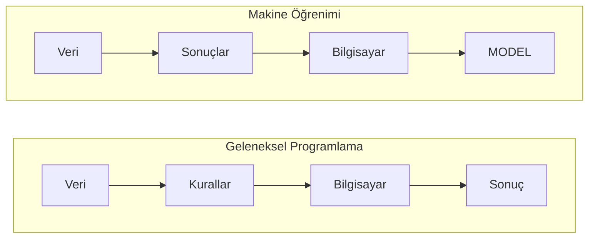
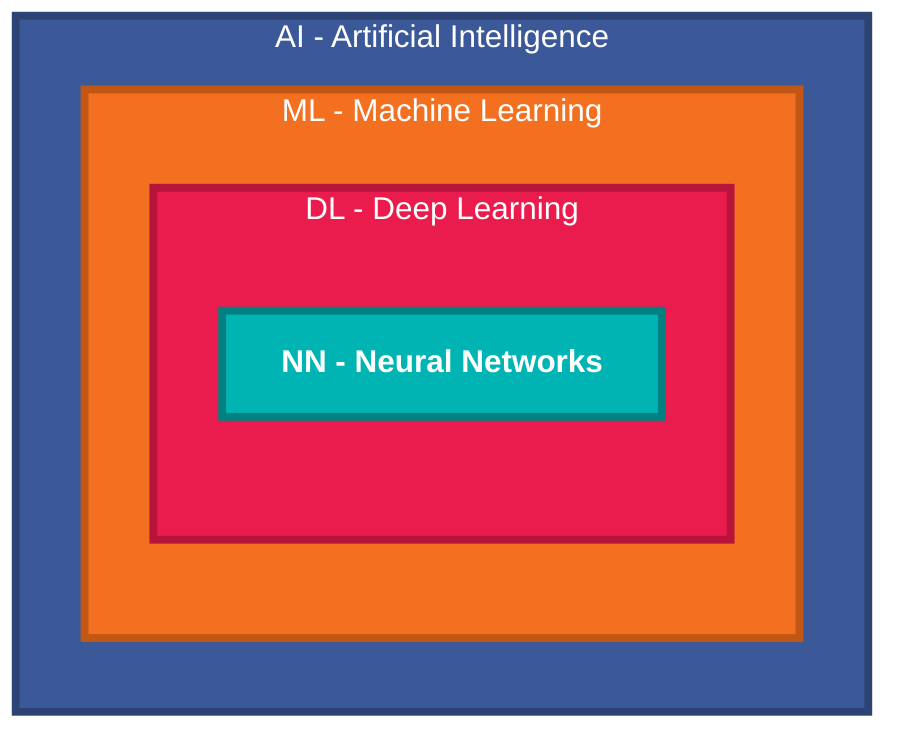
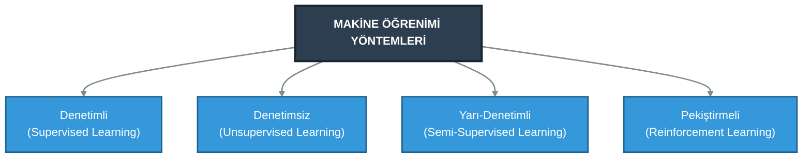
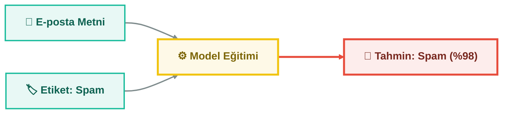
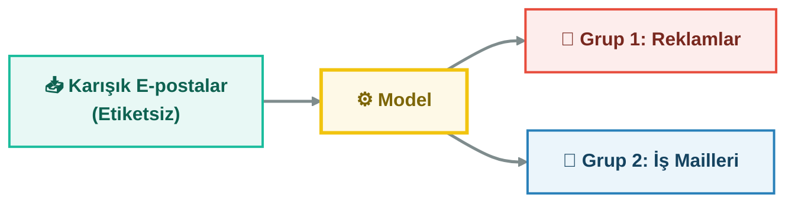
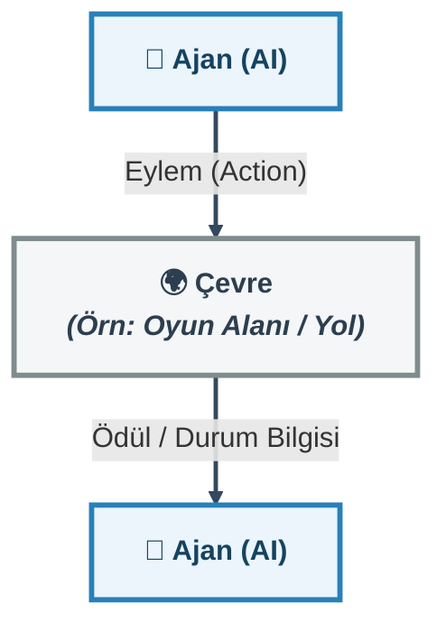

# Yapay Zeka & Makine Öğrenimi 🤖

## Başlangıç:
Çoğu insan yapay zeka ile makine öğreniminin aynı şey olduğunu sanır lakin aslında bunlar birer iç içe geçmiş kavramlardır. Yapay zeka ise bunların bütünüdür.

Öncelikle Yapay Zeka(Artiffical intelligence)'nın ne olduğuna bir bakalım

- **Yapay Zeka:** İnsan zekasını, karar verme mekanizmalarını ve öğrenme yeteneğini bilgisayar ortamında taklit eden tüm sistemlerin genel adıdır.(Şemsiye kavram)


- **Makine Öğrenimi (Machine Learning ML):** Yapay zekanın alt dalıdır. Kabaca **programlanmadan, veriden öğrenerek tahminler yapan veya kararlar alan algoritmalar bütünüdür.** 

Peki.. ne demek **programlanmadan ?** Kabaca şöyle anlatabilirim..

## ⚡ Geleneksel Programlama vs. Makine Öğrenimi
Eğer bilgisayara tam anlamıyla her şeyi programlayacak olsanız (ki bunu yapmanız mümkün olmaz) milyarlarca olasığı hesap etmeniz gerekirdi. Örneğin diyelim ki bir spam e-posta aracınız olsun. İşte size basit bir spam e-posta örneği:
```
Konu: Bedava hediye kazandınız!

Tebrikler! Bedava iPhone kazandınız. Hemen tıkla ve bilgilerini gir: sahte-link.com

Bu fırsat kaçmaz, tıkla kazan!

Saygılar,
Ödül Ekibi
```

Bu maili "spam" olarak işaretlemek isteseydiniz maildeki genel bağlama bakmanız gerekirdi. Burada biz "bedava" kelimesini hedef alalım. Diyelim ki "bedava" kelimesi bir mailde geçiyorsa o mail spamdir. Bunu yapmak için geleneksel yazılımda şu algoritmayı uygulamanız gerekirdi:

```
Eğer => Mailde varsa => "Bedava":
    işaretle => spam
değilse:
    işaretle => güvenli
```

Artık bir maili spam olarak işaretleyebiliyor olursunuz. Ama bu mekanizmayı atlatmak çok kolay olurdu! Eğer maili size b.e.d.a.v.a şeklinde gönderirsem mekanizmanızı çok rahat atlatmış olacağım. Siz kodunuzu buna göre güncelleyeceksiniz, bu sefer ben b-e-d-a-v-a yazıp yine mekanizmanızı atlatacağım. Özetle bunun bir sonu yok! Her olasılığı tek tek koda dökmeniz imkansızdır.

İşte Makine Öğrenimi (ML) tam burada devreye girer. Biz kuralları elle teker teker yazmak yerine, sisteme binlerce e-posta veririz. Algoritma e-postaların içindeki kalıpları (bunlara ileride **"desenler / patterns"** diyeceğiz) kendisi inceleyerek spam olma kurallarını kendisi keşfeder.

Makinenin veriler ve algoritmalar vasıtasıyla kendi kendine öğrenme sürecine **Machine Learning (ML)**, bu öğrenme sonucunda ortaya çıkan kurallar bütününe ise **Model** adını veriyoruz.



## 📐 Kavram Hiyerarşisi

## 🔄 Makine Öğrenimi Öğrenme Yöntemleri
Makine öğrenimi algoritmaları veriyi işleme ve öğrenme biçimlerine göre 4 temel kategoriye ayrılır:


## 🟢 1. Denetimli Öğrenme (Supervised Learning)

Sisteme **hem girdiler (X) hem de doğru yanıtlar/etiketler (Y)** verilir. Model, girdiden doğru yanıtı bulmayı öğrenir.

- **Öğretmen Mantığı:** Bir öğrenciye **çözümlü soru bankası verip arkasındaki cevap anahtarıyla birlikte çalıştırmak** gibidir.

**Temel Alt Alanlar:**

* **Sınıflandırma (Classification):** Veriyi kategorilere ayırır (E-posta Spam mi Değil mi?, Kedi mi Köpek mi?).

* **Regresyon (Regression):** Sürekli sayısal bir değer tahmin eder (Ev fiyatı tahmini, Hava sıcaklığı tahmini).


## 🔵 2. Denetimsiz Öğrenme (Unsupervised Learning)
Veri setinde **hiçbir etiket veya yanıt yoktur.** Algoritma, **verinin** içindeki gizli **desenleri, benzerlikleri ve grupları kendisi keşfeder**.

- **Kaşif Mantığı:** Bilmediğiniz bir gezegendeki taşları renklerine ve boyutlarına göre kendi kafanızda gruplamak gibidir.

**Temel Alt Alanlar:**
* Kümeleme (Clustering): Benzer verileri gruplar (Müşteri segmentasyonu, haberleri konularına göre ayırma).

* Boyut İndirgeme (Dimensionality Reduction): Karmaşık verileri basitleştirir (Görsel sıkıştırma).

## 🟡 3. Yarı-Denetimli Öğrenme (Semi-Supervised Learning)
Elimizde çok az miktarda etiketli veri ve devasa miktarda etiketsiz veri olduğunda kullanılır.

- **Örnek:** Fotoğraf arşivinizdeki 10.000 fotoğraftan sadece 50 tanesine kimin olduğunu yazarsınız, model kalan 9.950 fotoğrafı bu 50 fotoğraftan yola çıkarak kendisi eşleştirir.
## 🔴 4. Pekiştirmeli Öğrenme (Reinforcement Learning)
**Model (Ajan / Agent)**, bir çevre içinde **deneme-yanılma** yoluyla öğrenir. Doğru hamle yaptığında **Ödül (Reward)**, yanlış yaptığında **Ceza (Penalty)** alır. Amacı **toplam ödülü en yüksek düzeye çıkarmak**tır.

- **Oyun Mantığı:** Bir oyunda yüksek skor yapmayı deneme-yanılma ile öğrenen yapay zeka.

- **Kullanım Alanları:** Otonom araçlar (Tesla), Satranç/Go oynayan yapay zekalar (AlphaGo), Robotik kol hareketleri.
